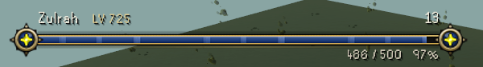
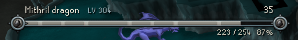
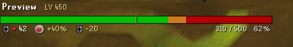

# Boss Health Bar Additions

A bigger, themed health bar for the boss you're fighting, with a damage trail, your latest hit and extra boss info around it.

Join the [support Discord](https://discord.gg/YPugUP8rg2) for help, bugs and ideas, or right-click the bar and pick Support Discord.

See the [changelog](CHANGELOG.md) for what's new in each version.

## What it does

- Replaces the opponent health bar with a wide, themed bar: name, combat level and hitpoints, a damage trail after each hit, a low health pulse, and the damage of your latest attack (or your party's)
- Takes over the game's own boss health bar, using its exact hitpoints and phase markers. The other bars the game shows with it are drawn in the same style: a second bar a boss carries besides its health, such as an energy bar, becomes a thin strip under the bar, and pillar bars get their own movable box
- A smaller second bar shows another boss you're fighting at the same time, with its last known health while it's away
- Remembers a boss you walk out of sight of: come back to it in the same area and the bar carries on with its health and fight time, without "Defeated" or the intro
- Optional info around the bar: kill count, fight timer, elemental weakness, defence drain limit, party and magic defence, special attack counts
- Themes: god themes, a custom theme with your own colours and icon, the boss's own icon and colours, a plain Oldschool look, and the game's textures over the fill
- Its own panel in the sidebar for nearly every setting, with the game's items and sprites for the icon, and Import and Export to keep a setup or pass it on

It only shows what the game already tells you, plus a timer for how long the fight has lasted. No attack timers or prediction.

## Which opponents get a bar

Bosses from a [built-in list](docs/bosses.md), anything the game's boss health bar shows, and superior slayer monsters. Add or leave out NPCs by name or ID with Also show for and Never show for, or turn off Only show for bosses to get the bar on everything.

The bar stays on the boss while you hit its minions, follows the game's boss bar between the NPCs of a group fight, and stays up while the fight goes on, even when you stop to move or eat.

## Works with

| Plugin | What the bar does with it |
|---|---|
| Opponent Information (RuneLite) | Turns its health bar off while this plugin runs, so you don't see two. Your setting comes back after |
| Chat Commands (RuneLite) | Reads the kill counts it saves |
| Special Attack Counter (RuneLite) | Shows its counts with each weapon's icon |
| Party (RuneLite) | Damage number can add up the hits of party members who also run this plugin |
| Boss Health Indicators | Draws the health lines you set up there on this bar |
| Party Defence Tracker / Better Party Defence | Shows the defence (and magic defence) from their info boxes |

## Settings

The settings live in two places. The plugin's own panel holds the look of the bar, the text, the boss info, the animations, the layout and the custom colours. Open it from its sidebar icon, or right-click the bar and pick Open panel. The fonts and when to show a bar are on the RuneLite settings screen, which the settings button at the top of the panel opens; right-clicking the bar and picking Configure gets there too.

Turn on Preview, at the top of the panel, to try settings on a sample opponent without a fight. Hold Alt to move the bar or drag its edge to resize it. The pillar bars box resizes the same way, and so does the second bar's own box, where dragging its top or bottom edge also sets how thick that bar is.

In the panel:

| Section | What's in it |
|---|---|
| Look | Theme, Oldschool theme, boss colours, phase colours, rare gold bars, icons, bar ends, fill texture, phase markers, size |
| Text | Name, combat level, hitpoints text (percentage, value, both or none), damage number and whose hits it counts |
| Boss info | Kill count, party defence, magic defence, special attack counts, elemental weakness, defence drain limit, fight timer, second boss bar, second bar on its own, second bar scale |
| Animations | Damage trail, heal speed, low health effect, flash on big hits, intro, defeat animation, burn away, fortify |
| Layout | Where each item goes: left, centre or right, above the bar, inside it, or on one of the two rows below it. Text inside the bar suits a taller bar |
| Custom colors | The colours of the Custom theme and its icon |
| Backup | Paste settings and Save debug log |

On the settings screen:

| Section | What's in it |
|---|---|
| The rest of the settings | An Open panel button: the look, the text, the boss info, the animations, the layout and the custom colours are in the panel |
| Fonts | Font and size of each text around the bar, Smooth text, and the text edge (shadow, outline or nothing) |
| When to show | Which opponents get a bar, Also show for / Never show for, Hide after, what happens to the game's boss bar (replace it, show both, or hide this one), and the other plugins above |
| Sidebar icon | Turn it off to give the sidebar its space back; the panel still opens from the bar's right-click menu |

The tooltip on each setting explains it in more detail.

## Import and Export

Import and Export sit at the top of the panel, where they can be reached whatever is open below.

**Export** writes a plain JSON file to `.runelite/plugin-data/boss-health-bar-additions/` and copies the same text to your clipboard, so a setup can be kept or passed to someone else. It holds every setting of this plugin you have changed, under the name that setting is saved as. A setting still at its default isn't in the file, because there is nothing saved for it.

Three things never travel, in either direction: the buttons that do something the moment you press them (the two pickers, Save debug log, Open panel, and Import and Export themselves), Preview, and the plugin's own notes on which one-off changes it has already made to your settings. A button would fire on import, and someone else's notes would make your copy skip or redo a change.

**Import** reads a file; **Paste settings** reads the same text off your clipboard. Either way it first says how many settings it is about to load, and loads nothing until you say yes. It takes only the settings this plugin has, and only values a setting can actually hold, so anything else in the file — another plugin's settings, a setting this version no longer has, a colour that isn't one — is counted as ignored and left out.

Loading is all or nothing: every setting this plugin has that the file doesn't name goes back to its default. What you get is the setup that was saved, not that setup on top of yours, so export your own first if you want it back.

## Reporting a bug

Right after the bar does something wrong, press Save debug log (Backup section of the panel) or right-click the bar and pick Save debug log. The file goes to `.runelite/plugin-data/boss-health-bar-additions/` and the chat says where. Attach it to a GitHub issue or post it in the [Discord](https://discord.gg/YPugUP8rg2). It holds the plugin and RuneLite versions, your settings for this plugin, which related plugins are on, and the plugin's last 1000 events (NPC names and IDs, times, game ticks). No player names, chat or account details; it's kept in memory only and nothing is sent anywhere.

## Data

The elemental weaknesses and defence drain limits come from the [Old School RuneScape Wiki](https://oldschool.runescape.wiki) and are built into the plugin, so it doesn't go online for them. [Supported bosses](docs/bosses.md) lists them per boss.

## Contact

Questions, ideas or bugs? Join the [support Discord](https://discord.gg/YPugUP8rg2), open an [issue on GitHub](https://github.com/Ghordrin/Boss-healthbar-additions/issues), or reach me on Discord at comrade9932 (Kuringe), or in game at Ultra Cringe.

## License

BSD 2-Clause, see [LICENSE](LICENSE).
